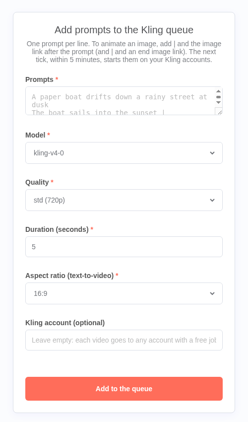
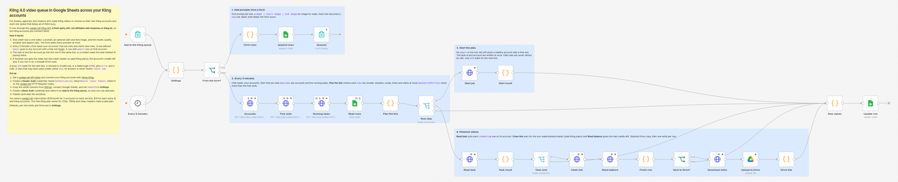

# n8n workflow for the Kling API

## Kling 4.0 video queue in Google Sheets across your Kling accounts

[`kling-sheet-batch.json`](./kling-sheet-batch.json) is a ready-to-import [n8n](https://n8n.io) workflow that turns a Google Sheet into a Kling video queue and keeps all your Kling accounts busy. Each row is one Kling 4.0 (or v3) video, from text or from a start and end image. It runs through the [useapi.net Kling API](https://useapi.net/docs/api-kling-v1?utm_source=github.com&utm_medium=referral&utm_campaign=kling-api), a third-party API, not affiliated with Kuaishou Technology or Kling AI, on the Kling accounts you connect there. It is built from core n8n nodes, with no community nodes.

One useapi.net subscription connects 3 Kling accounts for $15 a month, and each extra 3 cost $10 a month, so 10 accounts cost $45 a month and 30 cost $105 (as of October 2026). See [Run several Kling accounts](https://useapi.net/docs/api-kling-v1?utm_source=github.com&utm_medium=referral&utm_campaign=kling-api#run-several-kling-accounts).

1. The sheet has one row per video: `prompt`, an optional `image_url` (start frame) and `end_image_url`, and `model`, `mode`, `duration` and `aspect_ratio` (empty cells take the defaults in **Settings**). Copy the columns from [`kling-queue-sheet.csv`](./kling-queue-sheet.csv) into a tab named `Kling queue`.
2. The form is optional. Paste many prompts at once, one per line. Add `|` and an image link after a prompt to animate that image (and `|` and an end image link). Each line becomes a `new` row.
3. Every 5 minutes, the workflow reads your accounts, their free job slots and the running tasks (all free calls), then starts the `new` rows. A row without `email` goes to one of your healthy Kling accounts that has a free job slot: the API picks it. A row with `email` runs on that account. At most `maxStartsPerTick` jobs start per tick (default 10), and never more than your accounts have free slots, so each account stays within the `maxJobs` you set for it at useapi.net.
4. The same tick writes the task id and the account into the row, so a restart or a late tick reads the task instead of paying twice.
5. Finished rows get the video link (the clean, non-watermarked master when the Kling AI subscription allows it, else the preview), the account's real credit balance at that moment in `credits_left`, and, with `saveToDrive` on, a copy in Google Drive with its link in `drive_link`.

| `status` | What happens next |
|---|---|
| `new` (or empty) | the row is checked (model, duration, mode, aspect ratio, links), then started → `rendering`. A row that fails the check gets `error` and a note that says what to fix |
| `rendering` | the task is read on its account. When it is done → `done`, with `video_url`, `credits_left` and `drive_link` |
| `done` | finished. Set it back to `new` to make it again |
| `error` | Kling refused it, a value is wrong, or the account's login failed (`596`): the `note` says what to change. Then set it to `new` |
| `check job` | the start may have used credits (a `5xx` other than a content refusal or `596`, or no answer), so it was not sent again. A `rendering` row also gets it when its `task_id` is empty, when its account can't be found, or when the finished task has no video link. Check the account's tasks before you set it back to `new` (or write the account and set `rendering` again) |

### Errors

`429` (every account, or the pinned one, is at its job limit) means nothing was made: the row stays `new` and the next tick sends it again. A `400`, a `403` (the account can't use that model yet, nothing charged) and a Kling content refusal (`500` with a moderation code, nothing made) set `error` with Kling's own words. A `596` (the account's Kling login failed, nothing made) sets `error` with the API's message: update the account at useapi.net, then set the row to `new`. Any other `5xx`, or no answer, may already have started the job and used credits: the row goes to `check job` and is never resent. n8n's own retry is off on Start job (the paid POSTs) and on for the free reads.

### The token stays in n8n

The video links in the sheet are Kling's own CDN links, and the workflow downloads them for Google Drive without your useapi.net credential. Kling's links can stop working after a while, so turn on `saveToDrive` to keep the files.

### Setup

1. Get a [useapi.net API token](https://useapi.net/docs/start-here/setup-useapi?utm_source=github.com&utm_medium=referral&utm_campaign=kling-api) and connect your Kling accounts with the [Kling setup](https://useapi.net/docs/start-here/setup-kling?utm_source=github.com&utm_medium=referral&utm_campaign=kling-api). Set each account's `maxJobs` there: that is how many jobs it runs at once.
2. In n8n, import `kling-sheet-batch.json`.
3. Create a **Header Auth** credential: Name `Authorization`, Value `Bearer <your API token>`. Select it on the useapi.net HTTP Request nodes (**Accounts**, **Free slots**, **Running tasks**, **Start job**, **Read task**, **Clean link**, **Read balance**). **Download video** needs none.
4. Make a Google Sheet with a `Kling queue` tab and the columns from [`kling-queue-sheet.csv`](./kling-queue-sheet.csv). Put its id (the part of the URL between `/d/` and `/edit`) in `sheetId` at the top of **Settings**, and connect a Google Sheets credential to **Read rows**, **Update row** and **Append rows**.
5. Optional: set `saveToDrive: true` and `driveFolderId` in **Settings**, and connect Google Drive to **Upload to Drive**.
6. Create a **Basic Auth** credential (any username and password) and select it on **Add to the Kling queue**, so nobody else can add jobs to your accounts.
7. Publish (activate) the workflow. Add rows to the sheet, or open the form URL and sign in with that username and password.

### Requirements

You need a useapi.net subscription and one or more Kling accounts. Videos need a paid Kling AI subscription (Standard or higher), since the free plan has no video credits, and Kling 4.0 must be open to the account (a `403` says when it isn't yet).

### Customize

The defaults (model, mode, duration, aspect ratio), the per-tick limits, `cleanMaster` and the Drive folder are at the top of **Settings**. The schedule is on **Every 5 minutes**. If a tick runs longer than that (many Drive copies at once), lower `maxPollsPerTick` or space the schedule out, so two ticks don't copy the same video. Every request parameter is documented on [POST videos/text2video](https://useapi.net/docs/api-kling-v1/post-kling-videos-text2video?utm_source=github.com&utm_medium=referral&utm_campaign=kling-api) and [POST videos/image2video-frames](https://useapi.net/docs/api-kling-v1/post-kling-videos-image2video-frames?utm_source=github.com&utm_medium=referral&utm_campaign=kling-api).

Every endpoint is documented in the [Kling API reference](https://useapi.net/docs/api-kling-v1?utm_source=github.com&utm_medium=referral&utm_campaign=kling-api).
